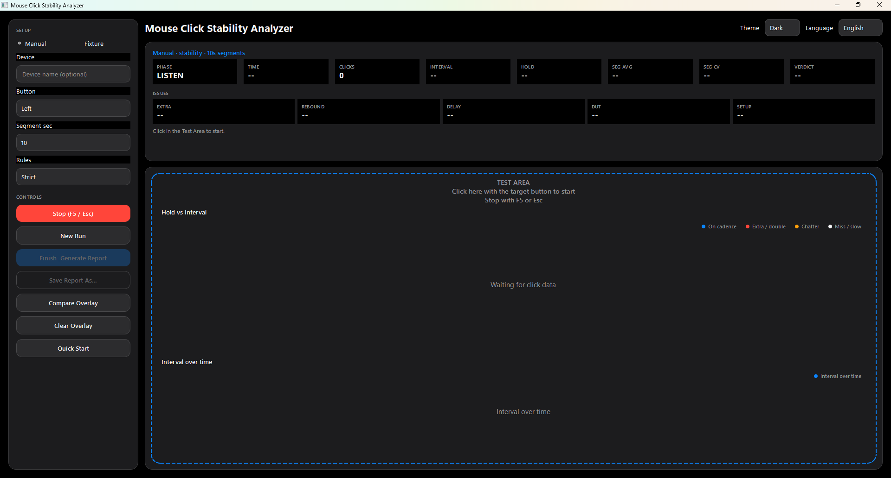
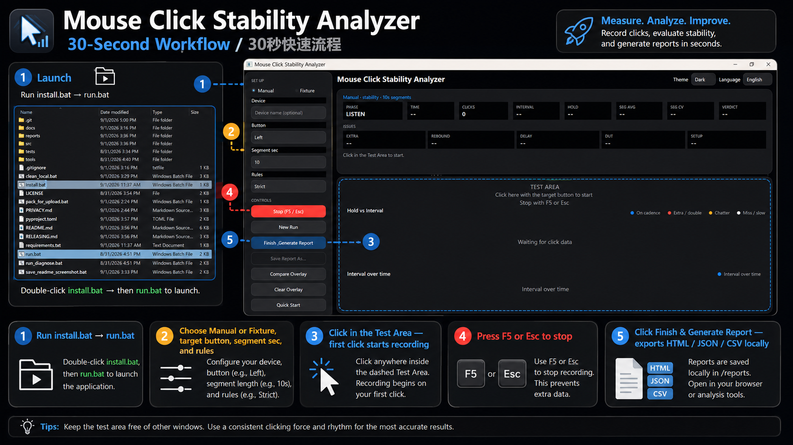

# Mouse Click Stability Analyzer

> **An independent QA prototype for capturing, measuring, visualizing, and reporting mouse click behavior.**

Author: **Leo Cheng, PMP** · License: [MIT](LICENSE)

## Screenshots

**Dark theme — LISTEN (ready to test)**



**30-second workflow**



| Step | Action |
|------|--------|
| 1 | `install.bat` → `run.bat` |
| 2 | Choose **Manual** or **Fixture**, button, Reference Rate, optional interval comparison, Auto Stop ON/OFF |
| 3 | Click in **Test Area** — first click starts recording |
| 4 | **F5 / Esc** to stop (avoids contaminating data) |
| 5 | **Generate Report** → evidence JSON, events CSV, HTML and XLSX locally |

## Why I Built This

Intermittent mouse click issues are difficult to explain with words or video alone. This project converts raw mouse events into measurable engineering evidence: press/release timing, hold duration and click intervals.

MCSA is **measurement only**. It records and visualizes what the host observed; it does not issue a PASS/FAIL verdict, a DUT score or a pass recommendation.

## What It Measures

- **Click interval** — press-to-press time between host-observed presses
- **Hold duration** — press-to-release time of each press
- **Configured interval range** (optional, Fixture) — inclusive bounds around the Reference Interval, set as ± ms or ± %. Intervals are counted as Below / Within / Above the range. This is a presentation of the configured range, **not** a PASS/FAIL criterion.
- **Auto Stop** — an explicit ON/OFF setting recorded in the evidence; ON stops recording after the configured duration
- **Schedule Association** (optional, historical) — readable only in runs that explicitly configured a Schedule Association Window. Normal runs do not configure one, and MCSA does not recommend a window value.

## Requirements

- **Windows 10/11** (Phase 1 — Raw Input capture)
- **Python 3.12 64-bit** for this release line (library metadata still allows 3.10+; that is not a production support claim)
- Verified GUI packages: `PySide6==6.11.0`, `openpyxl==3.1.5` (see `requirements-gui.txt`)

Recommended install folder: **`C:\MCSA\`** or **`C:\Tools\MCSA\`**. A deep OneDrive / Desktop path can push PySide6 files inside `.venv` past 260 characters on PCs without Windows long-path support.

## Quick Start

**Portable Windows EXE (no Python required):** extract `MCSA-1.0.0-win64.zip`, open the folder, and run `MCSA.exe`. Reports are written to `reports\` next to the executable. See `QUICK_START.txt` in that folder.

**From source (Python 3.12):**

```bat
cd C:\MCSA
install.bat
run.bat
```

`install.bat` creates a **project-local `.venv`** with Python 3.12 and installs the Qt GUI extras there. It does not install into global Python and does not require Administrator.

`run.bat` always runs **this folder's** `src\` with that `.venv` (or `py -3.12` / a 3.12 `python` if `.venv` is not present yet). It will not pick a newer Python, and it will not fall back to the legacy Tk UI.

If the window flashes and closes, run `run_diagnose.bat`.

Headless self-test (synthetic data, no GUI):

```bat
run.bat --mode self-test
```

The legacy Tk UI is available only by explicit request (`run.bat --ui tk`) and is not used for production.

Reports are written to `reports/` **after you complete a local run**. This repository does not ship real device sessions.

Before publishing: run `clean_local.bat` to remove local test reports and build cache (see [RELEASING.md](RELEASING.md)).

## Typical Workflow

1. Launch (`run.bat`) — app opens in **LISTEN**
2. Set Manual/Fixture, button, rules (left rail)
3. Move cursor to **Test Area**, click target button to **start**
4. Stop with **F5** or **Esc** (not the Stop button, to keep data clean)
5. Review the Results charts (Elapsed time vs Click interval, Click interval distribution, Elapsed time vs Hold duration, Click interval vs Hold duration) → **New Run** or **Generate Report**
6. Optional: **Compare Overlay** with a previous run's `mcsa_<run_id>_evidence.json` (from its `reports/mcsa_<run_id>/` package). Older flat `*_detail.json` files from before Stage 2C are still readable as legacy input but are no longer generated.

Reports land in `reports/` on your machine only (never committed — see [RELEASING.md](RELEASING.md)).

## Reading a Report — Demo Mouse A (fictional)

This example uses a **fictional device** for teaching only. Your real reports appear only after a local test.

| Field | Demo Mouse A example |
|-------|----------------------|
| Device | Demo Mouse A |
| Mode | Fixture, Reference Rate 3 Hz (Reference Interval 333.33 ms) |
| Run Status | COMPLETE |
| Analysis scope | Measurement only |
| Host Presses / intervals | 58 / 57 |
| Configured interval range | ±20 % → 266.67–400.00 ms |
| Within / Below / Above | 30 / 14 / 13 (Within 52.63 %) |

**How to interpret:**

- **Run Status COMPLETE** means the capture finished and all four artifacts were written — it is not a pass.
- **Within / Below / Above** describe where each click interval falls relative to the range you configured. They are not PASS/FAIL results.
- The **Click interval distribution** colours bars by range position; bars never cross the range bounds.

## Project Structure

```text
src/mouse_click_stability_analyzer/
  app.py          # Tk GUI + reporting (legacy / fallback)
  qt_shell/       # PySide6 portfolio shell (default when installed)
  core.py         # Metrics engine (importable)
  cadence.py      # Reference Rate / Reference Interval helpers
  schema.py       # MCSA_EVIDENCE_V1 schema constants and tool version
  cli.py          # mcsa command
  adapters/       # Windows Raw Input capture
```

## Roadmap

- [x] Phase 1A–1B: Public repo, MCSA schema, standalone GUI + self-test
- [x] Phase UI: PySide6 shell (Listen → first click → charts → review/report)
- [x] Phase UI+: Chart axes/legends, compare overlay, rules preset, dark theme, EFIGS+CJK UI
- [ ] Phase 1C: Device scan & bind (mouse HID enumeration)
- [ ] Phase 1D: Report localization beyond EN/ZH
- [ ] Phase 2: macOS capture adapter, packaging, CI


## Library API (preview)

```python
from mouse_click_stability_analyzer import build_payload, compute_metrics, make_synthetic_events

events = make_synthetic_events(count=100, interval_ms=100.0, hold_ms=12.0)
payload = build_payload("Demo Mouse A", "", {"fixture_hz": 10}, events, run_id="demo")
metrics = payload["metrics"]
```

## Privacy

See **[PRIVACY.md](PRIVACY.md)** for what data MCSA stores locally and what it does **not** collect.

See **[SECURITY.md](SECURITY.md)** for vulnerability reporting and the local-only security model.

- Operator name is **optional** (not auto-filled from Windows username)
- Do not commit `reports/` — real VID/PID sessions stay local
- Compare overlay JSON is capped at **32 MiB / 150,000 events**
- GitHub repo ships **no real test sessions** (`reports/*` is gitignored; only `reports/.gitkeep` is tracked)

## Acknowledgements

Built as a personal portfolio project. Development methodology used AI-assisted iteration; the analysis logic is deterministic event processing, not ML inference.
