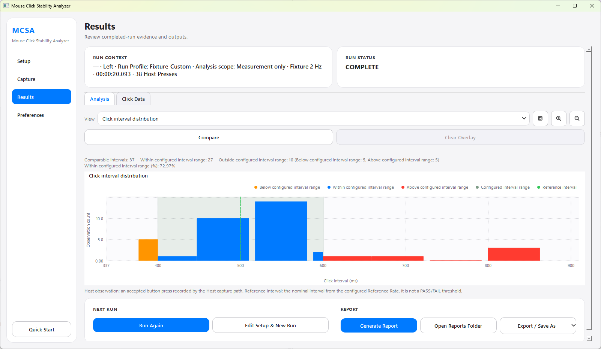
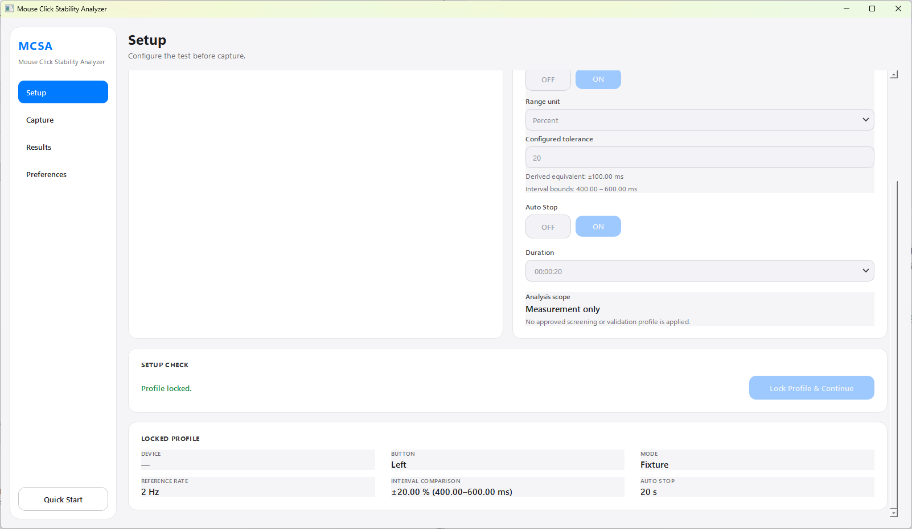
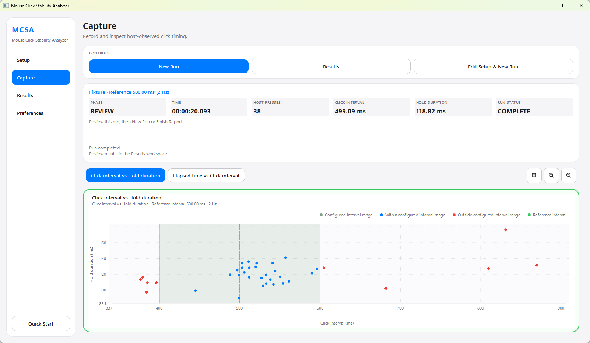
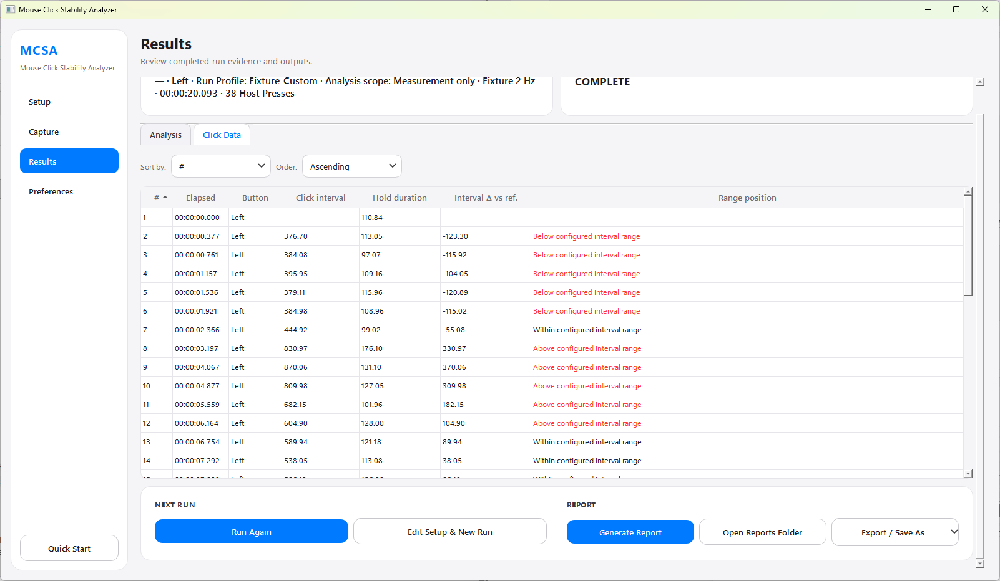
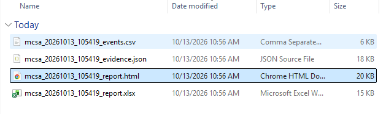
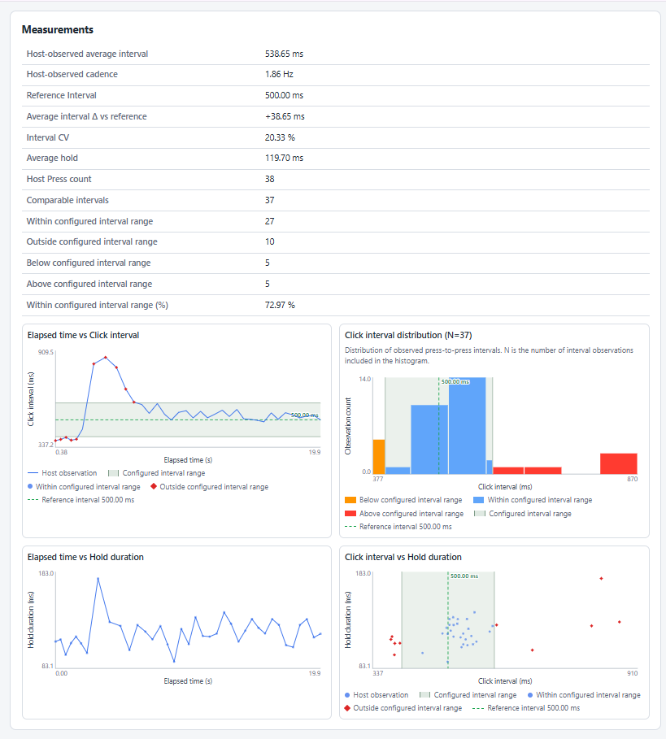

# MCSA - Mouse Click Stability Analyzer

> **A Windows engineering tool for host-observed mouse click timing measurement, visualization, comparison, and evidence reporting.**

**MCSA is measurement only.**
It records what the Windows host observed. It does not issue a DUT PASS/FAIL verdict, a score, or a product qualification recommendation.

**Author:** Leo Cheng, PMP
**License:** [MIT](LICENSE)

---

## Download

The current public release is **MCSA v1.0.0**.

**Windows 10/11 - 64-bit**

Download the portable Windows package from:

**[MCSA v1.0.0 - GitHub Release](https://github.com/kotori0802/MCSA/releases/tag/v1.0.0)**

Extract `MCSA-1.0.0-win64.zip`, then run `MCSA.exe`.

No Python installation is required for the packaged release.
No administrator rights are required for normal operation.

---

## Why MCSA

Intermittent mouse-click timing issues can be difficult to communicate using video or subjective descriptions alone. MCSA converts host-observed button activity into repeatable timing measurements and reviewable evidence for engineering investigation.

MCSA measures what the Windows host observed. It does not diagnose the physical switch and does not qualify the DUT.

---

## Results at a Glance



MCSA turns host-observed mouse button events into measurable engineering evidence.

The example above shows a completed Fixture run with:

- Reference Interval
- Configured Interval Range
- Below / Within / Above interval counts
- Host-observed Click intervals
- Measurement-only analysis scope

The configured interval range is a factual comparison aid. It is **not** a PASS/FAIL threshold.

---

## What MCSA Measures

### Click Interval

Press-to-press time between consecutive host-observed button presses.

```text
Press N -> Press N+1
```

The first accepted press has no previous press, so its Click interval is blank.

### Hold Duration

Time between the host-observed press and release of the same button.

```text
Press -> Release
```

### Reference Rate and Reference Interval

Fixture mode can be configured with a Reference Rate.

For example:

```text
Reference Rate:      2 Hz
Reference Interval:  500.00 ms
```

Reference Rate is configuration vocabulary. Milliseconds are used for timing analysis.

### Configured Interval Range

Fixture mode can optionally compare observed intervals with an inclusive range around the Reference Interval.

The range can be configured as +/- milliseconds or +/- percent.

MCSA then reports each comparable interval as:

- **Below configured interval range**
- **Within configured interval range**
- **Above configured interval range**

These describe measurement position only. They are not DUT verdicts.

### Auto Stop

Auto Stop is an explicit ON/OFF run setting.

When enabled, capture ends after the configured duration. Its state is recorded explicitly in the evidence rather than inferred from elapsed time.

---

## Setup



The Setup workspace defines the measurement conditions before capture.

Available configuration includes:

- Optional Device / DUT name
- Mouse button
- Manual or Fixture mode
- Reference Rate for Fixture mode
- Optional interval comparison
- Range basis and tolerance
- Auto Stop
- Duration

The profile is locked before capture so the completed run has a stable configuration record.

MCSA v1.0.0 uses:

```text
Analysis scope: Measurement only
```

No approved screening or validation profile is applied.

---

## Capture



The Windows release captures host-observed mouse button activity through the Windows Raw Input path.

During a run, MCSA records and presents:

- Host Press count
- Click interval
- Hold duration
- Elapsed time
- Run state
- Measurement charts

A completed run enters **REVIEW** and can be opened in the Results workspace.

`COMPLETE` means the run completed with accepted Host press evidence. It does **not** mean the DUT passed.

---

## Results

The Results workspace provides four primary chart views:

- **Elapsed time vs Click interval**
- **Click interval distribution**
- **Elapsed time vs Hold duration**
- **Click interval vs Hold duration**

For configured interval comparison:

- **Orange** - Below configured interval range
- **Blue** - Within configured interval range
- **Red** - Above configured interval range
- **Green band** - Configured interval range
- **Green reference line** - Reference Interval

These colors describe measured timing relative to the engineer-configured range. They do not represent PASS/WARN/FAIL states.

---

## Event-Level Evidence



The **Click Data** view exposes event-level measurement evidence.

Fields include:

- Event index
- Elapsed time
- Button
- Click interval
- Hold duration
- Interval delta vs Reference Interval
- Range position

This provides a direct path from summary charts back to individual host-observed events.

---

## Manual and Fixture Workflows

### Manual

Manual mode records host-observed mouse timing without a configured reference cadence.

It can be used to inspect Click intervals, Hold durations, timing variation, and raw host-observed event evidence.

### Fixture

Fixture mode adds a configured Reference Rate and derived Reference Interval.

Optional interval comparison can then show how observed intervals relate to the configured range.

---

## Compare Overlay

A completed run can be visually compared with a previous MCSA run.

Compare Overlay is intended for engineering review of measurement patterns. It does not reclassify the current run and does not turn either run into a DUT PASS/FAIL result.

---

## Run Status

MCSA uses factual run-state terminology.

- **COMPLETE** - At least one accepted Host press was recorded and the completed run is available for review.
- **NO_DATA** - No accepted Host presses were recorded.
- **INVALID** - The capture contains a validity condition that prevents it from being treated as a normal completed measurement.

Run Status describes the run. It is not a product verdict.

---

## Evidence Package



Selecting **Generate Report** creates exactly four artifacts for each run:

```text
reports/
  mcsa_<run_id>/
    mcsa_<run_id>_evidence.json
    mcsa_<run_id>_events.csv
    mcsa_<run_id>_report.html
    mcsa_<run_id>_report.xlsx
```

### Evidence JSON

Structured machine-readable run evidence using `MCSA_EVIDENCE_V1`.

### Events CSV

The factual event table contains:

```text
click_index
index
button
accepted
press_elapsed_ms
press_interval_ms
hold_ms
capture_source
device_source
```

The CSV intentionally contains no DUT verdict fields.

### HTML Report



A standalone human-readable engineering report. The generated HTML can be opened without MCSA or Python.

### XLSX Report

Spreadsheet representation of the completed-run evidence for engineering review.

---

## Windows Raw Input

MCSA v1.0.0 uses the Windows Raw Input path for host-observed mouse button capture.

No custom mouse driver is installed.

The portable Windows package contains its required runtime and does not depend on a system Python installation.

---

## Quick Start

```text
1. Download MCSA-1.0.0-win64.zip
2. Extract the ZIP to a writable folder
3. Run MCSA.exe
4. Configure Setup
5. Lock the profile
6. Start Capture
7. Review Results
8. Generate Report
```

Reports are written locally under `reports/` next to the executable.

---

## Requirements

### Portable Windows Release

- Windows 10 or Windows 11
- 64-bit Windows
- Physical mouse for real device measurement
- Writable folder for locally generated reports

Python is **not required** for the packaged release.

### From Source

The validated v1.0.0 development/build environment uses:

```text
Python      3.12 64-bit
PySide6     6.11.0
openpyxl    3.1.5
```

---

## Known Limitation - Windows Smart App Control

MCSA v1.0.0 is currently **unsigned**.

Windows SmartScreen may display a reputation warning.

On Windows 11 systems where **Smart App Control** is enforcing unsigned application blocking, Windows may prevent `MCSA.exe` from launching.

This is a known limitation of the unsigned v1.0.0 distribution.

Code signing is not configured for this release.

---

## Release Validation

The portable v1.0.0 candidate was validated on a clean Windows 11 environment without an MCSA source checkout, project `.venv`, or system Python.

The packaged application was validated with a real physical mouse for:

- Application startup
- Windows Raw Input capture
- Host Press recording
- Click interval measurement
- Hold duration measurement
- Auto Stop
- COMPLETE run state
- Results charts
- Configured Interval Range presentation
- Four-artifact report generation
- HTML report
- XLSX report
- Application restart

The generated XLSX was also validated by opening it with Microsoft Excel during release acceptance.

Smart App Control enforcement blocked the unsigned executable before launch; with Smart App Control not enforcing the block, the packaged application completed the runtime validation above.

---

## Schedule Association

Schedule Association remains an optional/historical analysis path.

Normal MCSA v1.0.0 runs do not configure a Schedule Association Window.

MCSA v1.0.0 does not publish or recommend an Association Window value.

Real 4E-B2 Association Window characterization has not started.

---

## Project Structure

```text
src/mouse_click_stability_analyzer/
  cli.py
  core.py
  cadence.py
  schema.py
  runtime.py
  adapters/
  qt_shell/
```

Release and packaging tooling is maintained under `packaging/`.

The production Windows interface uses **PySide6 / Qt**.

---

## Source Development

Typical source setup:

```bat
install.bat
run.bat
```

A project-local `.venv` is used for development dependencies.

Headless synthetic self-test:

```bat
run.bat --mode self-test
```

Release engineering information is documented in [RELEASING.md](RELEASING.md).

---

## Privacy

See [PRIVACY.md](PRIVACY.md).

- Operator name is optional.
- Real test reports remain local unless the user explicitly shares them.
- `reports/` is not intended to be committed.
- Device source information may contain hardware identifiers such as VID/PID.
- MCSA does not require a cloud service for measurement or report generation.

---

## Security

See [SECURITY.md](SECURITY.md) for vulnerability reporting and the local application security model.

---

## Scope

MCSA v1.0.0 is intended for:

- Engineering measurement
- QA investigation
- Timing evidence collection
- Reproduction support
- Run-to-run comparison
- Evidence reporting

It is not positioned as:

- A hardware certification system
- A DUT qualification authority
- A physical switch chatter diagnosis system
- A formal PASS/FAIL engine
- An ML/AI inference system

---

## License

MCSA is released under the [MIT License](LICENSE).

Third-party runtime licenses and notices for the packaged Windows distribution are included with the release package.

---

## Acknowledgements

MCSA is an independent personal engineering project.

Development used AI-assisted iteration for requirements refinement, implementation support, testing, and documentation.

The measurement pipeline itself is deterministic event processing, not machine-learning inference.
